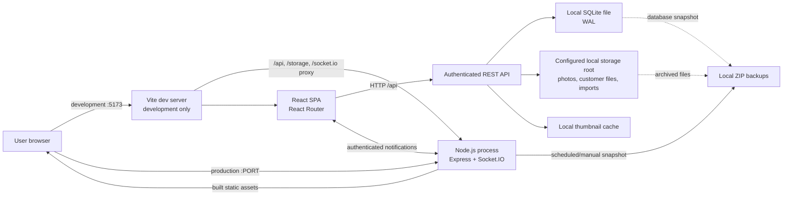
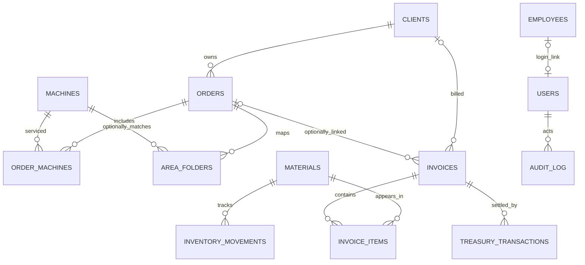
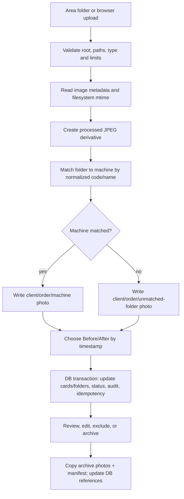

# Madar ERP — Architecture and Implementation Audit

**Review basis:** source implementation, isolated stabilization/audit, work-order COGS/historical issue conversion, v7 purchase-revision/employee-history/journal-navigation/overview work, v8 payroll attendance arithmetic, and v9 maintenance/manufacturing/warehouse schema on 2026-10-30. Results of the latest test/check/build run are recorded below; no live database, customer storage, existing backups, or uploaded workbooks were opened. This describes source-observed behavior, not a target design. Capability “phases” below are implementation-derived groupings; the repository does not provide enough release history to claim a dated rollout sequence.

This document's architecture walkthrough covers the legacy `system/` application. MADAR V2 is a separate project under `madar-v2/`; its latest hardening and verification are recorded in §8 of `SYSTEM_AUDIT_AND_STATUS.md` and in `MADAR_V2_COMPLETE_SYSTEM_REPORT.md`.

## 1. System at a glance

Madar is a locally hosted, single-instance web ERP for clients, operation and maintenance orders, machine/photo records, inventory, invoices, treasury, and reporting. The React application communicates with an Express API. Business records are stored in a local SQLite database; customer files, photos, imports, and backups remain on local disk. LAN or Tailscale access is a way to reach the host, not an application-level Tailscale or cloud integration.



**Network/data boundary:** `HOST` defaults to `127.0.0.1`; set it to `0.0.0.0` only when serving other LAN devices. HTTPS and `COOKIE_SECURE=true` are deployment/reverse-proxy concerns. The application has no cloud storage or external data-processing service in the reviewed paths.

## 2. Runtime and deployment

- **Current development environment — Windows:** use Node.js 22+ to satisfy the locked `better-sqlite3` engine requirement. From `system/`, `npm run dev` starts `nodemon src/server.js` and Vite on port 5173. Vite binds to `127.0.0.1` and proxies `/api`, `/storage`, and `/socket.io` to the API port (3100 by default). Local paths and Windows file-lock behavior should be considered during development.
- **Planned deployment — Ubuntu:** this is a future target, not the current runtime. Use Node.js 22+ and PM2. From `system/`, explicitly run `npm install` and `npm run build`, then start the service; `system/index.js` checks Node, installed dependencies, and the built SPA but never installs/builds during normal startup. Express serves the built SPA and API from one Node process. Ubuntu compatibility remains unverified until an isolated staging/restore drill passes.
- **PM2:** `ecosystem.config.js` intentionally configures one forked instance. SQLite and the filesystem watcher are local resources; do not scale this application to multiple PM2 workers without redesigning coordination and storage access.
- **Environment:** root `.env` is loaded by the API. `DATABASE_URL` defaults to `file:./system/data/madar.sqlite`; `STORAGE_ROOT_PATH` defaults to `./storage`; `BACKUP_ROOT_PATH` defaults to `Backups`; `THUMBNAIL_CACHE_PATH` defaults to `system/data/thumbnails`. Relative paths resolve from the repository root. `JWT_SECRET` is required and must contain at least 32 bytes. `TRUST_PROXY_HOPS` defaults to `0`; set it only to the known count of trusted proxy hops (allowed range 0–5). Login delay controls are process-local and configurable with `LOGIN_DELAY_BASE_MS`, `LOGIN_DELAY_MAX_MS`, and `LOGIN_DELAY_WINDOW_MS`.
- **Process handling:** fatal uncaught exceptions and unhandled rejections are appended to root `error.log`, then the process attempts a graceful shutdown. SIGINT/SIGTERM stop the backup task and watcher and close Socket.IO, Sequelize, and the direct SQLite connection.

## 3. Backend, frontend, and persistence boundaries

### Backend

`system/src/server.js` is the main API composition point. It configures Express security headers, compression, JSON/form parsing, authentication and role middleware, file upload handlers, business routes, Socket.IO, backups, and the area-folder watcher. API routes are mounted under `/api`.

Route families include:

- Authentication, first-run admin setup, and bootstrap data.
- Clients, employees, legacy workers, machine catalog/import, orders, machine cards, area-photo processing, and archiving.
- Storage explorer and file/thumbnail reads.
- Materials, inventory movements/import/export, purchase and sales invoices, receipts/payments, and treasury dashboard.
- Users/import/export, audit browsing, archive analysis, and customer report exports.
- Admin-only backup download/compatibility routes, staged restore and restart/recovery flow, and the scheduled backup runner.

The server is a large, route-oriented module rather than a set of independently mounted domain services. This is implemented and tested, but it increases the cost of isolating domain changes.

### Frontend

`system/src/main.jsx` mounts `App` inside `BrowserRouter`. `system/src/App.jsx` owns session/bootstrap state, shared navigation and modals, API helpers, notification state, and several inline business views. Domain page components exist for orders, machines, users, employees, settings, and archive analysis. Machine/photo review uses TanStack Virtual and dnd-kit; Socket.IO is used for area-folder notifications. The browser stores transient UI state; business state is read from the API.

Current routes include overview, clients, orders/order detail, machines, inventory, finance, archive, analysis, settings, users, and employees. `/workers` redirects to `/employees`; unknown routes redirect to overview.

### SQLite and data access

`system/src/db.js` opens the configured SQLite file using `better-sqlite3`, enables WAL, foreign keys, and a 5-second busy timeout, creates the initial schema, and runs additive migrations recorded in `schema_migrations`. Current SQLite `user_version` is 14. The v8 migration adds payroll absence columns; `operational-domains-secondary-warehouse-schema-v9` adds maintenance/manufacturing, offcut/scrap-sale tables and employee salary/login fields while preserving existing records; the v14 `workshop-inventory-issue-source-v14` migration preserves consumption rows and IDs while allowing manufacturing consumption from the material sub-warehouse. `system/src/models/index.js` maps the same database using Sequelize's SQLite dialect, backed by the `sqlite3` package, and initializes its connection/pragmas. **Both connections target the same file.** Production startup authenticates Sequelize; it does not use destructive `sync({ force: true })` or recreate the schema.

The API deliberately mixes parameterized handwritten SQL (`better-sqlite3`) with Sequelize models/transactions. This is a real convention of the current code, not a full ORM migration. Critical multi-row inventory, invoice/payment, and business mutations use database transactions; some routes also use persistent idempotency keys to prevent duplicate requests.

Major data domains:

- Identity: `users`, `sessions`, and `employees`; legacy `workers` records/routes remain.
- Operations: `clients`, `machines`, `orders`, `order_machines`, `area_folders`, and `maintenance_reasons`.
- Finance/inventory: `materials`, `inventory_movements`, `invoices`, `invoice_items`, and `treasury_transactions`.
- Cross-cutting: `counters`, `audit_log`, `idempotency_keys`, `sessions`, `filesystem_operations`, `backup_health`, and `schema_migrations`.



Photo path arrays and maintenance reason IDs are stored as JSON text on order-machine records; area-folder image paths/source paths are likewise stored as JSON text. The actual image bytes live in the filesystem, not SQLite.

## 4. Physical storage layout

The tree below is the configured, conceptual layout. It shows path shapes, not a listing of customer names or machine codes. `<client-name>` and `<order-code>` are sanitized path segments. The default root is repository-root `storage/` and can be moved with `STORAGE_ROOT_PATH`.

```text
<repository-root>/
├── .env                                  # local configuration; not committed
├── Backups/                              # configurable with BACKUP_ROOT_PATH
│   └── madar_backup_YYYYMMDD_HHMMSS.zip # SQLite snapshot + storage tree
├── error.log                             # fatal process diagnostics
├── storage/                              # configurable with STORAGE_ROOT_PATH
│   ├── Clients/
│   │   └── <client-name>/
│   │       ├── Logo/                      # uploaded client logo
│   │       ├── Invoices/                  # provisioned client directory
│   │       ├── Maintenance/<order-code>/
│   │       │   ├── <machine-code>/        # processed JPEGs before archive
│   │       │   └── Archive/
│   │       │       ├── <machine-code>/Before/ and After/
│   │       │       ├── Excluded/<machine-code>/Before/ and After/
│   │       │       └── order.json
│   │       └── Operation/<order-code>/    # same order/photo pattern
│   ├── Machines/<machine-code>/           # machine-catalog folders
│   ├── Areas/                             # source folders staged for matching
│   │   ├── .incoming/                     # transient upload area; excluded from watcher/backup
│   │   └── <area-or-import-folder>/
│   ├── .madar-recovery/<operation-id>/     # journal-owned same-volume deletion staging
│   └── Uploads/Excel/                     # persistent machine/import source files
├── system/
│   ├── data/madar.sqlite                  # default database (plus SQLite WAL/SHM files)
│   ├── data/thumbnails/                   # default derived WebP thumbnail cache
│   ├── dist/                              # production SPA build output
│   └── node_modules/
└── system/src/
```

Order-photo ingestion creates compressed JPEG derivatives under the client/order tree and records their relative storage paths in SQLite. The source files in `Areas/` are not rewritten by this process. Archiving copies photos into an order-local `Archive/` tree, separates included and excluded machines, writes an `order.json` manifest, and updates the database references/status. Derived exports/thumbnails do not replace source/archive image bytes.

The daily backup uses SQLite's online backup API to produce a snapshot, then writes that snapshot, a format manifest, and the configured storage tree into a local ZIP. `.incoming`, `.madar-recovery`, temporary order-deletion stages, and generated legacy user-import workbooks (including nested `Uploads/Excel/` paths) are omitted; an empty-storage marker preserves the storage root in the archive. The default schedule is 02:00 (`BACKUP_CRON` can override it). Admins can download a fresh ZIP with `POST /api/backup/create`; the compatibility endpoint `POST /api/system/backups` creates a copy in `BACKUP_ROOT_PATH` and returns its filename. The persisted health row records last success/failure time, successful archive bytes, and duration; the authenticated `/api/operations/status` endpoint and Settings panel show this alongside free space and pending recovery counts. It does not define retention or an independent backup destination.

Before a backup or restore, the API briefly rejects new requests, drains active API requests and background area-photo processing, and then snapshots/swaps data. SQLite's online backup API supplies the database snapshot; local storage is archived while API-managed writers are quiescent. Direct external edits to the storage directory are outside the application's lock. Restore accepts a ZIP through Admin-only `POST /api/backup/restore` (`file` multipart field), validates CRCs, archive paths/types/sizes, schema markers/migration compatibility, SQLite integrity/foreign keys, and active database-referenced storage paths in schema-v2+ archives. Schema-v3 archives must carry both integrated-finance migrations, schema-v4 archives must also carry `work-order-cogs-v1`, schema-v5 archives must carry `manufacturing-account-mappings-v1`, schema-v6 archives must carry the other-invoice-attachments table and migration marker, schema-v7 archives must carry the purchase-invoice-revisions table and migration marker, and schema-v8 archives must carry the payroll attendance migration and columns. Active purchase/other-invoice evidence paths are validated; soft-deleted records and historical `.incoming` source paths are not required in the backup. Restore stages both components and creates a pre-restore rollback ZIP, journals the swap, and rolls an interrupted swap back on startup. After a successful swap the process exits so PM2/nodemon can restart it; a bare `node` process must be restarted by its operator. Restore upload and extracted-size limits can be configured with `BACKUP_RESTORE_MAX_UPLOAD_BYTES` and `BACKUP_RESTORE_MAX_EXTRACTED_BYTES` (defaults 10 GiB and 100 GiB). Settings provides the download, status, and typed-confirmation restore workflow.

## 5. Main data flows

### Authentication and requests

1. First-run setup creates the initial administrator; login verifies a bcrypt password and issues a signed seven-day JWT in the `madar_session` HttpOnly, SameSite=Strict cookie. Setup is single-use after the first account exists. Login uses an in-memory, per-client-IP progressive delay (bounded, reset on successful login/window expiry, no permanent lockout) and a generic failure response for known/unknown usernames.
2. Each authenticated API request verifies the JWT, re-reads the user from SQLite, and checks a SHA-256 token hash in `sessions`. Logout deletes that session row, revoking copied cookies immediately; deleted/disabled users are also rejected. Secret rotation invalidates all JWTs and requires coordinated re-login.
3. `requireAuth` and `allowRoles` gate routes. Socket.IO validates the same cookie and joins role rooms for operational/admin notifications.
4. The SPA loads `/api/bootstrap` and refreshes shared business data after mutations.

### Order and photo lifecycle



Timestamp precedence is EXIF `DateTimeOriginal`/`CreateDate`, supported filename timestamps, then filesystem `mtime`; file birth time is not used. Exact ties are placed in Before for manual correction. Matching uses normalized folder names/codes, and an optional area constraint restricts the machine candidate set. The archive operation leaves source files intact and creates byte-preserving archive copies. PowerPoint/Word output compresses in-memory derived buffers (maximum width 800 px, JPEG quality 75); PowerPoint photo rows rotate their rendered image 90 degrees.

Folder notifications are emitted only for new top-level directories under `Areas/`. Chokidar excludes `.incoming`, waits for writes to stabilize (3,000 ms / 500 ms polling), and the application additionally confirms a stable directory snapshot before notifying. It emits `areas:folder-added` and a compatibility event `newAreaFolder`; the current SPA listens to `newAreaFolder`. The authenticated REST list remains available independently of notifications.

Order deletion soft-deletes the database row and stages its order folder by same-parent rename first. If the transaction fails, the handler attempts to rename the folder back. If rollback fails, API activity and scheduled backups are stopped and the process exits after returning the error; startup recovery restores the staged folder for an active order, or finishes removing it when the row is already soft-deleted. Startup refuses to serve if a stage is unsafe or both active and staged folders exist. This is recoverable staging, not secure erasure; an OS supervisor restarts the process, while a direct local `node`/development run may require an operator restart. Windows can reject a rename/removal while files are open.

### Inventory and finance

- Main warehouse balances are whole units; fractional reusable stock is held in `sub_stock` (offcuts). The API accepts and validates `auto`, `sub`, or `main`; a main withdrawal rounds up and transactionally records the remainder as offcut. The issue form now offers automatic (offcuts first), sub-warehouse only, or full-unit main-warehouse withdrawal. `system/src/inventory.js` contains the arithmetic; transaction routes persist material balances and movement history.
- Purchase invoices are immediately paid from the factory cashbox and atomically add stock, invoice lines, inventory lots/movements, treasury expense, a balanced journal entry (pending until mappings are approved), and audit history. A purchase can select a saved material variant or create one from normalized name, specification, unit, and purchase price; this never merges/reprices existing legacy materials. Invoice evidence is stored under configured local storage. Admin-only revisions append before/after snapshots with reason, actor, stock movements, cash delta and journal link; they require an expected revision number and all current-revision receipt lots to remain untouched. Reductions require explicit supplier-refund confirmation, increases require sufficient cash, and stock/cash/accounting changes run transactionally. Full-refund cancellation remains a separate one-time action, preserving the original invoice/evidence/history.
- Other-expense invoices are immediately paid, retain categorized line items, and support optional locally stored image/PDF evidence. Sales invoices snapshot subtotal, selected or invoice-specific custom tax basis points, and tax amount rounded upward to the next EGP 0.10. The tax summary supports either or both optional date bounds. A cash sale records the full invoice total as paid and creates its linked treasury receipt and balanced journal entry in the same database transaction as the invoice. A credit sale records a receivable; later full or partial receipt vouchers update paid/remaining/status and treasury/journal records transactionally. Purchase and sales invoices are not soft-hidden through the generic invoice-delete route; corrections preserve their financial and stock audit trail.
- Journal entries are queued against system mappings; standard manufacturing inventory/WIP/COGS/consumption defaults are seeded and approved by schema-v5, while other mappings remain pending until an Admin/accountant approves a compatible active account. Posted entries require balanced integer-cent debits/credits. Admin accounting pages expose the chart/mapping setup, pending entries, browsable/filterable journal entries with date, source type/ID, and account filters plus links to supported source screens, Admin-only audit browsing, trial balance, account ledger, date-filtered income statement, as-of balance sheet, tax summary, open-receivable schedule, opening-balance drafts/schedules, and payroll. Opening-draft edits audit the complete before/after line schedules. Opening balances are explicit cutover schedules, not an import of historical transactions; only one cutover batch may post, and all opening schedules must be consolidated into that balanced batch. A cashbox opening line contributes to current spendable cash, while pre-cutover treasury movements are not double-counted after the cutover. Employee advances, payroll accrual, actual cash paid, advance application, unpaid salaries, and later salary payments are separate auditable events; the Admin payroll table exposes the per-employee calculation components. Admins can view an employee timeline of assigned orders, payroll, advances, linked treasury movements, and audit snapshots, filter by dates, and export the history to Excel/PDF.
- Every new inventory issue is explicitly classified as an order issue or general consumption; order issues require a valid active order. Legacy-order issues retain their `inventory_issues` link; workshop-order issues use `manufacturing_material_consumptions`, update the workshop order's costed material record, and store `manufacturing_order` as the movement source. FIFO lot consumptions determine gross inventory value, reusable offcuts retain the consumed lot's cost, and the issue records net work-order cost. Order issues debit Work-in-Progress (WIP); general issues debit inventory consumption; both credit inventory and reclassify reusable offcuts back to inventory. Archiving an order transfers each posted WIP issue to work-order COGS. Schema-v5 seeds and approves the standard inventory, WIP, COGS, and general-consumption mappings so their journals post automatically; pre-existing custom account choices and their approval state are preserved. Pending mapped entries retry after mapping approval, and completed-order recognition waits until the related WIP issue journal is posted. Order detail exposes actual FIFO cost to Admins, while `/api/accounting/reports` and the finance dashboard return order-linked invoice revenue, FIFO cost, gross profit, pending journal counts, and a warning when historical issues remain unclassified.
- Historical issues can be converted with `node scripts/convert-historical-ledger.js --source <source.sqlite> --crosswalk <crosswalk.json>` (dry-run) and, after review, `--output <new-copy.sqlite> --actor-user-id <active-admin-id> --apply`. The source is opened read-only; apply makes a new SQLite backup copy and refuses to overwrite existing paths. The crosswalk must explicitly map every legacy negative issue movement ID to `{"classification":"order","orderId":...}` or `{"classification":"general"}`. Recorded lot-consumption costs are used where available; otherwise `grossCostCents` is mandatory. Optional `offcutCostCents` allows historical reuse value to be excluded from COGS. Conversion preserves movement dates, links movement/order/journal/audit records, and uses stable source keys to prevent duplicate journal entries. It does not infer order links from free-text references and does not backfill historical invoice/cash journals.
- Stock counts require a reason, snapshot book balances for the selected material variants, and lock only included materials against stock movement or catalog deletion while open. Admins enter actual main/offcut quantities, see per-warehouse and total variance before approval, and approve transactional adjustments with movement, journal, and audit history. Audit rows preserve before/after counted quantities and approved quantity variances. Valued manual balance edits require a reason and queue balanced inventory/variance journal entries; opening stock and bulk inventory-import balances remain on the explicit cutover workflow rather than receiving an inferred historical counterpart. Persistent Admin notifications track low stock, failed backups, and pending recovery; reviewed events can resolve and reactivate, with Socket.IO refresh events plus REST polling.
- The Admin finance dashboard reports date-filtered treasury inflow/outflow (owner funding is not sales income), current cashbox, inventory value, receivables, and gross profit for invoices linked to orders less FIFO-valued work-order material COGS. The Admin overview combines operational order indicators with finance/cashflow metrics; non-Admin overview remains role-scoped. Historical issues that have not been explicitly converted are counted and flagged; a pending account mapping is visible separately from the computed operational COGS. Order history is Admin-only and reads audit events tied to the order. Sales users have the sales-invoice view.

## 6. Delivered capability slices

These are implementation-derived capability groupings, not a verified historical schedule.

1. **Local ERP foundation — implemented.** Initial admin setup, role-based login, clients, users, machine catalog, operation/maintenance orders, counters, SQLite persistence, and SPA navigation are present.
2. **Machine/photo operations — implemented.** CSV/XLSX machine import, area folders, machine matching, before/after sorting, thumbnails, order review, archive manifests and exports are present. Automated tests exercise photo timestamp precedence/ties, archive and export paths, and storage workflows.
3. **Inventory, purchasing, and treasury — implemented in source; accountant decisions remain.** Price/specification material variants, purchase and other-invoice evidence, immediate purchase cash settlement, provenance-checked supplier-refund correction and append-only auditable purchase revisions, categorized other invoices, sales tax snapshots, full cash-sale collection and separate credit-sale receipts, persistent notification events, two-warehouse/offcut arithmetic, explicit work-order issue classification, FIFO valuation, and the historical issue-conversion utility have additive migrations and isolated coverage. Historical invoice-to-treasury migration behavior is unchanged; the conversion utility does not infer or backfill invoice journals.
4. **Accounting, stocktaking, and payroll — implemented in source; not production/accountant-approved.** Additive schema-v4/v5 and follow-up migrations support balanced mapped journals, standard manufacturing mappings, two-step WIP-to-COGS recognition, trial balance/ledger/statements, order-linked FIFO cost, opening schedules, advances/payroll, stock-count locks/adjustments, Admin journal/audit browsing with source navigation and filters, and Admin audit/order history. Standard inventory/WIP/COGS/consumption defaults are auto-approved while existing custom mappings are retained; opening cutover/date/schedules, funding/variance counterparts, and applicable tax rates still require owner/accountant approval. Historical gross profit remains flagged incomplete until legacy issue movements receive an explicit reviewed crosswalk and necessary costs.
5. **Employee and audit controls — implemented with legacy overlap.** Employee records, optional linked login accounts, actor-aware audit data, Admin-only audit browsing, soft deletes, and role-scoped API endpoints exist. Admins have date-filtered employee history with Excel/PDF exports across assignments, payroll, advances, treasury, and audit events. Maintenance field employees can be records without a login. Legacy workers entities/routes remain in the backend; the `/workers` page URL redirects to `/employees`.
6. **Local operations, reporting, and backup/restore — implemented with operational limits.** Settings/storage explorer, scheduled/manual ZIP backups, Admin-only backup download and typed-confirmation restore, folder watcher, Excel exports/imports, archive analysis, PowerPoint/Word exports, and browser print output exist. Restore validates and stages the database and storage archive, saves a rollback backup, journals the swap, and recovers an interrupted swap on startup. The visible master-list Excel export includes active machines, groups by area, sorts Arabic names, uses LTR sheet direction, and leaves unnoted rows blank; internal filtered Excel/PDF report modes remain in the API. Backups remain local and there is no retention policy or off-host copy.

## 7. Source review and test status

Verification results for the latest stabilization edits are recorded in §10. API integration tests use temporary SQLite and storage paths. These tests do not establish production-data integrity, Ubuntu compatibility, or real power-loss durability. No dependency vulnerability audit or external CVE lookup is claimed.

## 8. Risks, unfinished work, and technical debt

Priorities reflect risk from the reviewed implementation, not an incident finding.

### Conditional — broad file visibility and network exposure

`GET /api/storage/files`, `GET /api/files`, and `GET /api/files/thumbnail` require authentication but do not apply customer- or role-scoped file restrictions. The three routes now reject path traversal and symlink components and resolve reads under the configured storage root. This matches the stated current use by trusted administrators; it is not isolation between business users. Reassess only if accounts become less trusted or non-administrator users are introduced. As with local filesystem checks generally, external processes that mutate storage concurrently are outside the API's coordination; do not describe the check/read sequence as protection against hostile concurrent filesystem changes.

Route-level storage reads and staged deletion paths reject symlink components under the configured root. This does not mean every photo consumer uses one shared resolver: export/archiving paths still have separate validation logic. A local external process that mutates `storage/` concurrently with a read is outside the API's coordination and should be assessed separately if that threat is in scope.

### High — filesystem/database recovery and backup operations

Order deletion has its existing same-parent staging/recovery path. Photo-file deletion, area-folder/machine-photo eradication, machine-import deletion, and machine-catalog wipe now use a SQLite operation journal and marked staging under `storage/.madar-recovery/<id>`: staging happens before the business transaction, transaction failure restores the files, and startup rolls back prepared operations or completes committed cleanup. Unsafe prepared or unjournaled stages stop startup for manual review. Failed committed cleanup remains journaled and is surfaced in operations status; the service can continue, but backup/restore is blocked until recovery completes. These paths are source-tested with isolated transaction-failure and interrupted-operation fixtures, but Windows/Ubuntu power-loss and filesystem durability behavior has not been drilled. Direct writes to storage outside the API are not quiesced by the application snapshot lock. Scheduled and generated backups still have no approved retention policy or independent destination, so disk exhaustion, host loss, and correlated local-media failure remain unresolved disaster-recovery risks.

### Medium — transient image-processing status

Area-processing jobs and progress are held in process memory. A restart loses visible job status even though already-written files/DB state may exist. Persist job state or provide a restart/reconciliation strategy if long-running imports must survive process restarts.

### Medium — dual database access and legacy employee model

Handwritten SQL/`better-sqlite3` and Sequelize/`sqlite3` share one SQLite file, so schema and transaction behavior must remain aligned across both interfaces. `workers` and worker-linked fields remain alongside `employees` and employee-linked fields; the UI is migrated, but backend routes/mappings and migration backfills are not fully retired. Consolidate only through an explicit compatibility plan; do not delete legacy records or relations casually.

### Conditional — internal notes in archives and order details

`GET /api/orders/:id` returns machine-card `note` values to any authenticated account. Customer PPTX/DOCX/print queries select maintenance reasons and photos without those notes, but the archive `order.json` records notes for included and excluded cards. With the current trusted-administrator use this is not a new role-separation requirement; treat archive files as internal if shared outside Madar, and revisit if the audience changes.

### Conditional — initial setup, login guessing, and HTTPS

The first-run setup endpoint is unauthenticated until it creates the first account. Login now uses a bounded, process-local per-IP progressive delay, performs a dummy bcrypt comparison for unknown/inactive usernames, and returns the same generic failure response. This is not a distributed limiter and resets on process restart; keep ingress restricted and complete setup before network exposure. Seven-day JWTs are recorded by SHA-256 token hash in `sessions`; logout revokes the presented token. Terminate HTTPS at a trusted reverse proxy and set `COOKIE_SECURE=true`. Configure `TRUST_PROXY_HOPS` only for the exact trusted proxy chain; a wrong value can let clients influence IP-based throttling and secure-cookie detection.

### Medium — photo archive housekeeping

Restore validation now rejects schema-v2-and-later archives with missing active file/directory references; schema-v3 archives must carry both finance migration markers, schema-v4 archives must carry the work-order COGS marker, schema-v5 archives must carry the manufacturing-account mapping marker, schema-v6 archives must carry the other-invoice-attachments table and marker, schema-v7 archives must carry the purchase-invoice-revisions table and marker, schema-v8 archives must carry the payroll attendance marker/table columns, schema-v9 archives must carry the operational-domain migration, its required tables, and employee columns, and schema-v14 archives must carry the workshop-inventory-issue migration and sub-warehouse consumption support. Active purchase and other-invoice evidence paths are included. Soft-deleted orders/invoices/folders and `.incoming` sources are intentionally excluded. Existing records can retain historical paths after physical data has been removed; review any restore rejection in an isolated copy rather than editing a live database or weakening validation without an explicit consistency policy.

### Requirement gaps and decisions still open

- **Work-order cost policy:** the supplied requirements conflict over WIP/COGS recognition. Current behavior remains WIP on issue and COGS recognition when the order is archived; no accounting-policy change was inferred.
- **Accountant/owner approval:** opening-balance cutover date/schedules, funding and inventory-variance counterpart accounts, sales-tax rates, and historical issue classifications/costs require explicit approval before production use. The cash-sale-vs-credit-sale policy is resolved for this scope: cash invoices collect in full when saved; credit sales use separate receipt vouchers.

### Dependency review — unresolved

`system/package-lock.json` pins dependency resolution and includes both `better-sqlite3` (direct SQL) and `sqlite3` (Sequelize's SQLite driver). The locked `better-sqlite3` 13.0.3 package declares Node.js `>=22`; both manifest and lockfile root now state `>=22`. Service startup checks Node, required packages, and the built frontend and no longer installs/builds implicitly. No `npm audit` or external vulnerability lookup was run, so this review makes no current CVE/severity claim. Review lockfile advisories individually before any upgrade; do not apply automatic dependency changes.

### Medium — API module size and test distribution

Most API domains, storage operations, exports, watcher, and backup logic reside in `system/src/server.js`; several frontend views also remain inline in `App.jsx`. Pure logic has focused tests, and the API integration suite is broad, but a monolithic server makes boundaries harder to maintain and raises the risk of unrelated changes.

### Operational notes

- PM2 is intentionally single-process; a second instance would duplicate watcher/scheduler work and share a local SQLite file.
- `.env`, `storage/`, backups, SQLite files, thumbnail cache, build output, and logs are ignored by Git. Protect these separately and include both the database and storage files in any supported backup/transfer procedure.
- `skills.mcp` is a project JSON prompt pack, with no source/documentation reference found that loads it automatically; treat it as unused reference material unless an explicit loader is added. The root CIB/Nabak PNGs have no references in the inspected application or docs; a CIB-specific report layout is unverified and requires a product/reference-design decision.
- The user-provided operating assumption is that all users are administrators. The database and `allowRoles` checks still retain the current role model; no role records or behavior were removed in this work.

## 10. Stabilization pass: verified source behavior and remaining operations

- User-import workbooks are held in Multer memory storage, parsed from the buffer, and cleared in a `finally` block. New user-import files therefore do not enter browsable storage. Names matching the previous generated user-import pattern are hidden by storage browsing and file reads, and excluded from future ZIP backups. Existing files are deliberately preserved; no old workbook was inspected.
- Multi-photo uploads enforce a configurable total request-byte cap and process-local concurrency limit. Each request writes into a marked, private `.incoming` workspace; normal and Multer-error paths clean it. Startup cleanup is limited to stale, marked Madar workspaces containing only expected regular upload files. Unmarked, unknown, or legacy flat temporary files remain untouched.
- Invoice and treasury input validation parses decimal currency to cents and rejects more than two decimal places; purchase invoice totals are accumulated in integer cents. SQLite money columns and representation are unchanged.
- New databases record Madar's SQLite `application_id` and `user_version`; schema v6 adds other-invoice attachments and schema v7 adds append-only purchase-invoice revision history. Restore validation checks SQLite integrity, required tables, foreign-key violations, supported application/schema versions, and manifest/schema agreement. Unmarked legacy databases remain accepted for migration; unknown application IDs and future schema versions are rejected. When introducing a new schema contract, update `CURRENT_SCHEMA_VERSION`, the additive migration, and backup-compatibility tests together.
- Latest Windows verification on Node.js 24.21.0 (2026-10-30): `npm test` passed 46/46 tests, `npm run check` passed, and `npm run build` passed with 1,640 modules transformed. Vite reports the existing large-chunk warning (605.98 kB minified JS). Isolated API coverage includes workshop-linked invoice projections, bootstrap workshop counts, and FIFO material issues linked to workshop orders from both main and sub-stock. Migration/restore/model tests cover the schema-v14 migration marker, preserved workshop-consumption schema, employee fields, and Sequelize associations. No production data, existing backups, customer files, or previously uploaded workbooks were opened. Ubuntu, real power-loss durability, an independent security review, and dependency vulnerability audits remain unverified.
- Backup monitoring now records success/failure metadata, output size/duration, free space, and pending recovery counts; it does not select a destination, retention window, RPO, or RTO. **Owner decisions required:** choose among same-disk local copies, a separate local/removable medium, a trusted on-premises LAN destination, or encrypted offline media; choose a retention approach (manual/no automatic deletion, capacity-triggered review, or an approved time/count rule); define backup cadence and resulting RPO; and set an RTO only after a timed restore drill. No backups were deleted and no numeric policy is approved by this audit.
- Passwords possibly present in legacy user-import workbooks were not inspected. Treat credentials that may have appeared in those files as potentially exposed: restrict filesystem access, require affected users to reset passwords, avoid reusing temporary passwords, and rotate the JWT secret only with an approved coordinated logout/redeployment plan. Do not delete old uploads or backups without an explicit retention decision.

### Follow-up checklist: crash recovery and Ubuntu staging

- [x] **Photo deletion/eradication and machine-catalog wipe:** use a transactional SQLite operation journal and same-volume marked stage, roll back prepared operations at startup, finish committed cleanup, and fail closed on unsafe prepared or unjournaled recovery data. Committed cleanup failures remain visible and block backup/restore. Isolated tests cover transaction failure, prepared recovery, committed cleanup, and unexpected stage contents.
- [ ] **Crash injection on target filesystems:** exercise process termination around each rename, DB commit, and cleanup boundary on isolated Windows and Ubuntu staging hosts; confirm filesystem durability and operator recovery procedures. Unit tests are not a substitute for these drills.
- [ ] **In-memory image-processing jobs:** persist job state and per-file progress, stage derived outputs before publishing references, make retries idempotent, and reconcile interrupted jobs on startup without rewriting archived originals.
- [ ] **Ubuntu staging and restore drill:** use an isolated VM/host and a staging copy that excludes production `.env`, `storage/`, `Backups/`, SQLite files, and historical uploads. Create a staging-only environment file with temporary credentials and paths; install Node 22+, run `npm ci`, `npm test`, `npm run check`, and `npm run build`; apply least-privilege service-user permissions to the staging DB, storage, backup, thumbnail, log, and built-asset paths; start exactly one PM2 fork. Confirm setup-before-network-exposure, firewall/reverse-proxy behavior, exact `TRUST_PROXY_HOPS`, HTTPS/secure cookie, login/logout revocation, uploads and photo processing, backup health, backup CRC/schema/reference checks, restore rollback copy, PM2 restart/shutdown, and free-space reporting. Restore only synthetic staging data, verify representative records/files, and measure recovery time before selecting owner-approved RPO/RTO targets. Ubuntu compatibility and crash recovery remain unverified until this checklist is completed.

## 9. Key implementation references

- `system/src/server.js` — API, auth/roles, uploads, finance/accounting/payroll, inventory, exports, watcher, and backup/restore orchestration.
- `system/src/backup-restore.js` — ZIP validation/extraction, SQLite checks, staged restore, audit record, and interrupted-swap recovery.
- `system/src/filesystem-recovery.js` — journaled same-volume storage staging, rollback, and startup recovery for destructive storage workflows.
- `system/src/login-throttle.js` — bounded in-memory progressive login delays.
- `system/src/components/settings/SettingsPage.jsx` — Settings storage explorer and backup/restore confirmation workflow.
- `system/src/db.js` — direct SQLite schema-v14 migrations, counters, and audit helper.
- `system/src/models/index.js` — Sequelize mappings and associations.
- `system/src/inventory.js` — stock/offcut arithmetic.
- `system/src/photo-time.js` — image timestamp precedence and before/after split.
- `system/src/App.jsx` and `system/src/components/` — SPA state, routes, order history, accounting, and domain pages.
- `system/index.js`, `system/vite.config.js`, `ecosystem.config.js` — startup, development proxy, and PM2 runtime.
- `system/test/` — API, migration, inventory, photo-time, runtime, model, and area-folder rename coverage.
