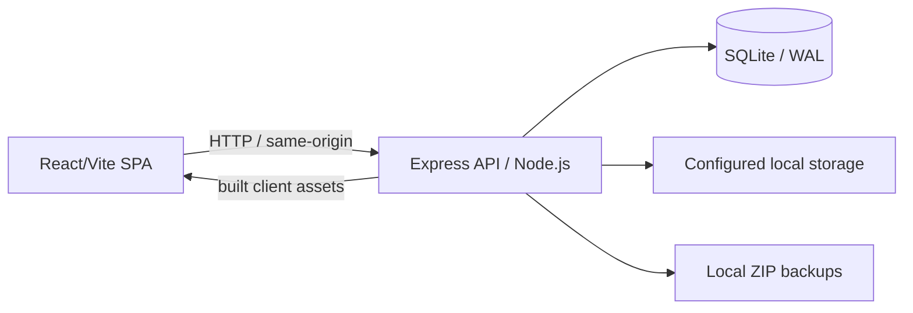

# MADAR V2 — Complete System Report
# تقرير نظام MADAR V2 الكامل

**Verification date / تاريخ التحقق:** 3 November 2026
**Scope / النطاق:** MADAR V2 source, historical configured SQLite initialization, isolated automated tests, client production build, local startup smoke test, and current authentication/photo/GPS/event/database-maintenance changes. Current test runs use temporary SQLite and storage roots; they do not inspect or modify the configured business database or customer files. This is an evidence-based implementation report, not a certification or external security audit.
**النطاق:** مراجعة كود MADAR V2 وتهيئة SQLite التاريخية والاختبارات المعزولة وبناء العميل وتشغيله محلياً وتغييرات الحماية والصور وGPS والأحداث وصيانة قاعدة البيانات الحالية. استخدمت الاختبارات الحالية قواعد SQLite ومجلدات تخزين مؤقتة ولم تفحص أو تعدل قاعدة الأعمال أو ملفات العملاء المضبوطة. هذا تقرير تنفيذ مبني على الأدلة، وليس شهادة جاهزية أو تدقيقاً أمنياً خارجياً.

## 1. Executive overview | الملخص التنفيذي

MADAR V2 is a local-first web application: a React/Vite client is served by an Express/Node.js API, business data is stored in one SQLite database using WAL, and uploaded/customer files and ZIP backups remain on configured local disk. The tested production entry point serves both the API and the built client from one process. No cloud service is required for the verified workflows.

MADAR V2 تطبيق يعمل محلياً: واجهة React/Vite تخدمها واجهة Express/Node.js، وتُحفظ بيانات الأعمال في قاعدة SQLite واحدة بوضع WAL، بينما تُحفظ ملفات العملاء والمرفقات والنسخ الاحتياطية ZIP على القرص المحلي وفق المسارات المضبوطة. نقطة التشغيل المختبرة تخدم الواجهة والـ API من عملية واحدة، ولا تعتمد الوظائف التي تم التحقق منها على خدمة سحابية.

**Maintenance and Acrylic Workshop are logically separated, not physically isolated.** They use distinct order/card and workshop/design/material workflows in the same database. The isolated suite verifies that maintenance orders reject workshop pricing/cost fields and that the two order lists and lifecycles remain separate. This is evidence of the tested application boundary, not proof that every future change or every operational scenario is immune from cross-domain mistakes.

**الصيانة وورشة الأكريليك منفصلتان منطقياً وليستا قاعدتي بيانات مستقلتين.** لكل مجال جداول ومسارات عمل منفصلة داخل قاعدة البيانات المشتركة. تتحقق الاختبارات المعزولة من رفض أمر الصيانة لحقول سعر/تكلفة الورشة ومن فصل قوائم الأوامر ودوراتها. يثبت ذلك حدود التطبيق المختبرة، لكنه لا يمثل ضماناً لكل تغيير مستقبلي أو لكل حالة تشغيلية.

### Architecture at a glance | البنية باختصار

- **Runtime / التشغيل:** Node.js 22+ is declared by the V2 package; verification ran on Windows with Node.js 24.21.0. SQLite access uses `better-sqlite3`, foreign keys, WAL, and transactional service operations.  
  **بيئة التشغيل:** يتطلب المشروع Node.js 22+؛ وأُجري التحقق على Windows باستخدام Node.js 24.21.0. يستخدم SQLite مكتبة `better-sqlite3` مع المفاتيح الخارجية وWAL والمعاملات.
- **Current binding / عنوان الاستماع الحالي:** configured port is `3000`; the loaded configuration currently reports `HOST=0.0.0.0`. The startup smoke test deliberately overrode this to `127.0.0.1` to avoid exposing the temporary test server.  
  **عنوان الاستماع الحالي:** المنفذ المضبوط `3000`، وقيمة المضيف الحالية `0.0.0.0`. استخدم اختبار التشغيل `127.0.0.1` مؤقتاً لتجنب إتاحة خادم الاختبار على الشبكة.
- **Storage / التخزين:** database defaults to `madar-v2/data/madar-v2.sqlite`; file and backup roots are configurable. Business files are stored outside SQLite.  
  **التخزين:** المسار الافتراضي لقاعدة البيانات `madar-v2/data/madar-v2.sqlite`، ومسارات الملفات والنسخ الاحتياطية قابلة للضبط. تُحفظ الملفات خارج قاعدة SQLite.

## 2. Production database initialization | تهيئة قاعدة الإنتاج

Before initialization, an online SQLite snapshot was created and independently checked. The snapshot is local at:

`C:\Users\Carlos.wok\AppData\Local\Temp\opencode\madar-v2-pre-db-init-2026-10-31T07-51-09-079Z.sqlite`  
**SHA-256:** `288256db984a90a5932a158bb4848f3574f6897cba7c97204da7f8474609b9b2`

تم إنشاء نسخة SQLite متسقة أثناء التشغيل وفحصها قبل التهيئة. مسار النسخة محلي كما هو موضح أعلاه، وبصمتها SHA-256 مسجلة معها.

`npm run db:init` completed successfully and applied migration **`20261031-maintenance-trip-folder-engine`**, which adds `maintenance_unmatched_folders`, its order/status index, and the migration marker. The migration is additive.

اكتمل الأمر `npm run db:init` بنجاح، وطُبّق الترحيل **`20261031-maintenance-trip-folder-engine`**. أضاف الترحيل جدول `maintenance_unmatched_folders` وفهرس الطلب/الحالة وعلامة الترحيل، دون إعادة إنشاء المخطط.

| Check / الفحص | Result / النتيجة |
|---|---:|
| Active Carlos administrator / حساب Carlos الإداري النشط | Present / موجود |
| CIB client `C-1001` / عميل CIB | Present / موجود |
| Machines / الماكينات | 514 |
| Maintenance-order rows / سجلات أوامر الصيانة | 16 (1 active, 15 soft-deleted / نشط واحد و15 محذوفة منطقياً) |
| Maintenance cards / بطاقات الصيانة | 115 |
| Pre-existing table contents / محتوى الجداول السابقة | All 28 tables matched the snapshot on common columns / تطابق محتوى الجداول الـ28 مع النسخة السابقة |
| Migration table, index, marker / الجدول والفهرس وعلامة الترحيل | Present / موجودة |
| SQLite integrity / سلامة SQLite | `ok` |
| Foreign-key violations / مخالفات المفاتيح الخارجية | 0 |
| Journal mode / وضع السجل | `wal` |

The comparison excluded `schema_migrations`, where the expected new version was recorded. No customer storage files were read or modified during this finalization. Tests used temporary databases and storage roots.

استثنى التطابق جدول `schema_migrations` لأن إضافة إصدار الترحيل متوقعة. لم تُقرأ ملفات تخزين العملاء أو تُعدّل خلال هذه الخطوة، واستخدمت الاختبارات قواعد بيانات ومجلدات تخزين مؤقتة.

## 3. Implemented systems and features | الأنظمة والوظائف المنفذة

### Field maintenance and trip engine | الصيانة الميدانية ومحرك الرحلة

- Area-based order creation, sequential `MN-` codes, assignment of active Maintenance employees, optional visit notes, and optional population from machines in the selected area. Cards are constrained to the order area.  
  إنشاء أوامر حسب المنطقة برموز `MN-` متسلسلة، وإسناد موظفي الصيانة النشطين، وإضافة ملاحظات، مع إمكانية إدراج ماكينات المنطقة. تُقيّد البطاقات بماكينات منطقة الأمر.
- `POST /api/maintenance/orders/:id/process-folder` accepts a ZIP upload or an approved server folder under `storage/Areas/` or `storage/Uploads/`. ZIP processing enforces upload/entry/expanded-size limits, rejects unsafe paths and ZIP symlinks, and ignores `.incoming`.  
  يقبل المسار ملفات ZIP أو مجلداً على الخادم ضمن `storage/Areas/` أو `storage/Uploads/`. توجد حدود للحجم والملفات، ورفض للمسارات غير الآمنة والروابط الرمزية داخل ZIP، واستثناء لمجلد `.incoming`.
- Machine matching normalizes Arabic forms (including Alef/Yaa), code, Arabic name, and English name against active machines in the order area. Ambiguous or unknown names are retained for human review rather than guessed.  
  يطابق المحرك رمز الماكينة واسمها العربي أو الإنجليزي بعد التطبيع، مع قصر البحث على ماكينات منطقة الأمر. تُحفظ الحالات الملتبسة أو غير المعروفة للمراجعة البشرية بدلاً من التخمين.
- Before/After classification uses nested Arabic/English phase directories, supported filename prefixes, then photo time (EXIF, supported filename timestamp, then file timestamp); unspecified photos are split chronologically, and exact ties stay in Before for correction.  
  يعتمد التصنيف على مجلدات قبل/بعد، ثم بادئات أسماء الملفات، ثم الوقت (EXIF ثم تاريخ مدعوم في الاسم ثم وقت الملف). تُقسّم الصور غير المحددة زمنياً، وتوضع التعادلات الزمنية في «قبل» للمراجعة.
- Unmatched folders and their photos are persisted; a user can bind a reviewed folder to a remaining machine in one action. This final migration now enables that persistent table on the configured database.  
  تُحفظ المجلدات غير المطابقة وصورها، ويمكن للمستخدم ربط المجلد بعد مراجعته بماكينة متبقية بخطوة واحدة. أصبح الجدول الدائم مفعلاً في قاعدة البيانات بعد الترحيل.
- New field photos are decoded and stored as JPEG derivatives (quality 80, maximum 1920×1080, no carried EXIF) under the configured `Areas/{area}/{machine}/{date}_{order}/{before|after}/{uuid}.jpg` layout. Archived source images are not rewritten. Legacy visits with an interrupted UUID-directory layout remain recoverable.
- Cairo (`Africa/Cairo`) is the default timezone. The additive timezone migration changes only a legacy `Asia/Riyadh` value; an explicitly configured different timezone is preserved.

### Machines directory and imports | دليل الماكينات والاستيراد

The UI provides Orders and Machines Directory tabs, area/search filters, paginated machine listing, create/edit/soft-deactivate actions, import preview, and Excel/CSV bulk upsert by stable machine code. Import preserves existing machine IDs and client-machine links, and provisions machine/area storage directories. The configured database currently contains 514 machine rows; the UI is paginated rather than loading the entire catalog in a single request.

توفر الواجهة تبويبي أوامر الصيانة ودليل الماكينات، والبحث والتصفية حسب المنطقة، وعرضاً مقسماً إلى صفحات، وإضافة/تعديل/تعطيل منطقي، ومعاينة واستيراد Excel/CSV بتحديث أو إدراج حسب رمز ثابت. يحافظ الاستيراد على المعرّفات وروابط العميل/الماكينة وينشئ مجلدات التخزين اللازمة. تحتوي قاعدة البيانات الحالية على 514 ماكينة، ويُعرض الدليل على صفحات.

### Reports and exports | التقارير والتصدير

- **PPTX:** branded 16:9 monthly-period cover, client logo when available (initials fallback), and a paginated machine index that points to each machine slide. Each machine slide includes up to four before and four after images, status, reason, and notes; slides are numbered. Export photos rotate 90° clockwise, then are resized to 800 px maximum width and JPEG quality 75 in derived in-memory buffers; stored files are never rewritten. Authenticated `GET` and `POST /api/maintenance/export/pptx` support current/selected order IDs or the all-archived default, optional reason/area filters, and an optional reason-only slide footer; the existing JSON-body API remains supported. The per-order PPTX route uses the same layout.  
  **PowerPoint:** غلاف بعلامة MADAR وفترة التقرير الشهرية، وشعار العميل عند توفره (أو الأحرف الأولى كبديل)، وفهرس صفحات يشير إلى شريحة كل ماكينة. تتضمن الشريحة حتى أربع صور قبل وأربع بعد والحالة والسبب والملاحظات مع ترقيم الصفحات. تُدار صور التصدير بلفّ 90 درجة مع عقارب الساعة ثم تصغيرها وضغطها داخل الذاكرة فقط، دون إعادة كتابة الملفات الأصلية. يدعم التصدير نطاق الأمر الحالي أو الأوامر المحددة أو كامل الأرشيف مع تصفية اختيارية بالسبب/المنطقة وتذييل اختياري يعرض سبب الصيانة فقط.
- **DOCX:** bilingual/Arabic maintenance report with order summary, inspection-card table, machine sections, and available before/after photos; derived photos also rotate 90° clockwise and are compressed in memory.  
  **Word:** تقرير صيانة عربي يتضمن ملخص الأمر وجدول البطاقات وأقسام الماكينات وصورها المتاحة، مع تدوير الصور المشتقة 90 درجة وضغطها في الذاكرة.
- **XLSX:** warehouse workbook export; the machine importer supports XLS/XLSX/CSV preview and upsert.  
  **Excel:** تصدير مستودع بصيغة XLSX، واستيراد الماكينات من XLS/XLSX/CSV مع المعاينة والتحديث.

**Customer-report caution:** current PPTX and DOCX generation includes `maintenance_cards.notes` (technical/internal card notes). Do not distribute these reports externally until the field is confirmed customer-safe, removed from customer exports, or separated into an explicitly internal report. This is a known policy gap, not a claim that the files were inspected visually.

**تنبيه للتقارير الخارجية:** يتضمن إنشاء PPTX وDOCX حالياً حقل `maintenance_cards.notes`، وهو ملاحظات البطاقة الفنية/الداخلية. لا تُرسل التقارير خارجياً قبل اعتماد هذا الحقل للعميل أو حذفه من تقارير العملاء أو فصل التقرير الداخلي بوضوح. هذه فجوة سياسة معروفة، ولم يتم فحص شكل الملفات بصرياً.

### Staff and HR | الموظفون والموارد البشرية

Employee records support departments, job title, phone, salary, activation/deactivation, daily attendance (`present`, `absent`, `late`, `leave`), overtime hours, tool issue/return custody, and monthly payroll draft/finalization. Current arithmetic is: daily rate = monthly base / 26; standard day = 9 hours; overtime = hourly daily rate × 1.5; absence deduction = daily rate per absent day capped at base salary. Finalization checks treasury cash, posts linked salary expenses, and audits the payroll run. Deactivating a linked employee disables the login and revokes sessions; reactivation does not silently restore the login.

تدعم سجلات الموظفين الأقسام والمسمى والهاتف والراتب والتفعيل، والحضور اليومي (حاضر/غائب/متأخر/إجازة) والساعات الإضافية وعهدة الأدوات (تسليم/إرجاع) ومسودة الرواتب الشهرية واعتمادها. الحساب الحالي: الأجر اليومي = الراتب الأساسي ÷ 26؛ يوم العمل القياسي 9 ساعات؛ الإضافي = أجر الساعة × 1.5؛ وخصم الغياب = أجر يوم لكل يوم غياب بحد أقصى الراتب الأساسي. يتحقق الاعتماد من رصيد الخزينة ويسجل مصروفات الرواتب المرتبطة ويضيف سجل تدقيق. تعطيل موظف مرتبط بحساب دخول يعطّل الحساب ويلغي جلساته، وإعادة تفعيل الموظف لا تعيد الدخول تلقائياً.

This is a limited payroll model: policies for holidays, leave treatment, bonuses, benefits, overtime approvals, advances, payslips, and employee settlement still need owner/accountant approval before payroll is treated as a final statutory calculation.

هذا نموذج رواتب محدود؛ سياسات العطلات والإجازات والمكافآت والمزايا واعتماد الإضافي والسلف وكشوف الرواتب والتسويات تحتاج إلى اعتماد المالك/المحاسب قبل اعتبار الحساب نهائياً.

### Field representative tracking and live operations | تتبع المندوبين والتحديثات المباشرة

- Browser GPS polling uses a fast interval while moving (12 seconds) and slows to 60 seconds after three stationary minutes; the Android foreground service switches from 5 to 60 seconds on the same rule. Detected movement restores the fast interval. The existing server-side 50 m stop/geofence accuracy margin remains in place. Background GPS remains subject to OS, browser, and OEM limits.
- Assignment and visit-review notifications, attendance/overtime refreshes, and supervisor field events use role-scoped in-process SSE. The UI also refreshes periodically to reconcile disconnects; these events are not durable or replayable.
- Weekly SQLite maintenance optimizes the database, checkpoints/truncates the WAL, and prunes GPS breadcrumbs older than 90 days. It runs in the single application process.
- Rep visit photos use UUID filenames directly in the `Areas/{area}/{machine}/{date}_{order}/{before|after}/` folders; interrupted uploads stage under `.madar-recovery/`. The recovery logic also handles legacy UUID-directory uploads.

يستخدم المتصفح استطلاعاً سريعاً كل 12 ثانية أثناء الحركة، بينما تستخدم خدمة Android الأمامية كل 5 ثوانٍ؛ وبعد ثلاث دقائق من السكون يتحول كلاهما إلى 60 ثانية، ويعودان إلى الفترة الأسرع عند اكتشاف الحركة. تظل مهلة دقة الـ50 متراً الحالية في تحليل التوقفات، مع بقاء GPS بالخلفية خاضعاً لقيود النظام والشركة المصنعة. تُرسل إشعارات الإسناد ومراجعة الزيارة وتحديثات الحضور/الإضافي وأحداث المشرف عبر SSE داخل العملية وبحسب الدور، مع تحديث دوري للمصالحة؛ وليست طابوراً دائماً أو قابلاً لإعادة التشغيل. تنفّذ صيانة SQLite الأسبوعية تحسيناً وفحصاً/تقليصاً لسجل WAL وحذف نقاط GPS الأقدم من 90 يوماً. تحفظ صور الزيارات بأسماء UUID داخل مجلدات المنطقة/الماكينة/التاريخ/المرحلة، مع دعم استعادة مجلدات UUID القديمة.

### Workshop and warehouse | الورشة والمستودع

Workshop orders have their own `MFG-` lifecycle, product/machine type, assigned Workshop staff, approved design-file types, ready/delivery transitions, and invoice linkage. Warehouse features include material catalog/stock, movements, issues to in-production workshop orders, tracked fractional offcuts, stock-count reconciliation, and scrap-sale income entries. Scrap sale and stock movement are committed transactionally. The service validates that workshop issues target a workshop order in production.

لأوامر الورشة دورة مستقلة برموز `MFG-`، ونوع المنتج/الماكينة، وفنيي الورشة، وأنواع محددة لملفات التصميم، وانتقالات الجاهزية والتسليم وربط الفاتورة. يشمل المستودع دليل المواد والمخزون والحركات والصرف لأوامر الورشة قيد الإنتاج وبواقي القصّ ذات الكميات الجزئية والجرد وتسوية الفروقات وإيرادات بيع الخردة. تُسجل عملية بيع الخردة وحركة المخزون ضمن معاملة واحدة، ويُتحقق من أن الصرف مرتبط بأمر ورشة قيد الإنتاج.

### Finance and treasury | المالية والخزينة

Money is represented as integer cents. Treasury exposes a calculated live cash balance and signed income/expense entries. Purchase invoices and stock restocks are transactional; workshop delivery creates an invoice but does not itself collect cash. Full/partial receipt vouchers update invoice paid/remaining/status and treasury separately. Maintenance petty-cash advances and archive refunds link to the order and treasury. Expenses reject insufficient available cash.

تُمثل الأموال بوحدات السنت الصحيحة. تعرض الخزينة رصيداً محسوباً حالياً وقيود دخل/مصروف. تُسجل فواتير الشراء وإضافة المخزون ضمن معاملة؛ أما تسليم الورشة فينشئ فاتورة ولا يعني تحصيل النقد تلقائياً. تحدّث سندات القبض الكاملة/الجزئية المدفوع والمتبقي والحالة والخزينة بشكل منفصل. ترتبط سلف الصيانة ورديات العهدة بالأمر والخزينة، ويُرفض المصروف عند عدم كفاية الرصيد.

### Security, users, and backups | الأمان والمستخدمون والنسخ الاحتياطية

Authentication uses bcrypt password hashes, signed HS256 JWTs in HttpOnly/SameSite=Strict cookies, database-backed session hashes, expiry/revocation, and a configurable Secure cookie flag. Both login forms share a process-local limit of five failed attempts per IP per minute and return an Arabic 429 response when exceeded; accounts lock for 15 minutes after five consecutive password failures and reset after a successful login. The user model supports `admin`, `sales`, `operations`, `rep`, and `purchasing`; user administration and backup/restore are protected workflows. MADAR's application ZIP backups contain the database and storage; restore validates ZIP paths and SQLite integrity before staged replacement. A separate `scripts/cloud-backup.sh` produces a local GPG AES-256-encrypted ZIP and never uploads data. Application backup/restore round-trip coverage passed on synthetic isolated data; the shell script has passed Bash syntax validation only, not an end-to-end encryption test. The IP limiter is process-local and assumes the configured trusted-proxy chain is correct.

يستخدم الدخول تجزئة كلمات المرور بـ bcrypt، ورموز JWT موقعة HS256 داخل ملفات تعريف ارتباط HttpOnly وSameSite=Strict، وجلسات مرتبطة ببصمات مخزنة في قاعدة البيانات مع انتهاء وإلغاء، وخيار Secure قابل للضبط. تشترك واجهتا الدخول في حد محلي قدره خمس محاولات فاشلة لكل IP في الدقيقة، مع استجابة عربية 429؛ ويُقفل الحساب 15 دقيقة بعد خمس إخفاقات متتالية ويُصفّر العداد عند نجاح الدخول. تشمل الأدوار `admin` و`sales` و`operations` و`rep` و`purchasing`. تحتوي نسخ MADAR التطبيقية على قاعدة البيانات والتخزين، وتتحقق الاستعادة من مسارات ZIP وسلامة SQLite قبل الاستبدال المرحلي. ينشئ `scripts/cloud-backup.sh` نسخة ZIP مشفرة محلياً بـGPG AES-256 ولا يرفع البيانات. اجتاز النسخ/الاستعادة التطبيقي اختباراً على بيانات اصطناعية معزولة؛ أما السكربت الجديد فاجتاز فحص Bash النحوي فقط ولم يُختبر تشفيره كاملاً. محدد IP يعمل داخل العملية ويفترض ضبط سلسلة الوكلاء الموثوقة بشكل صحيح.

## 4. Verification and measured performance | التحقق ومؤشرات الأداء المقاسة

**Current Windows verification (3 November 2026):** `npm test` passed **69/69** with isolated SQLite/storage fixtures; `npm --prefix client run build` passed (109 modules); `npm run android:sync` passed (client build plus Capacitor asset/plugin synchronization); `bash -n scripts/cloud-backup.sh` passed using Git Bash; and `git diff --check` passed. MADAR V2 has no `npm run check` script. No Android APK/Gradle build or PM2 restart was performed: JDK/Java, Android SDK configuration/tooling, and PM2 are unavailable here. The encrypted backup script was not executed end-to-end because `zip`, `gpg`, and `realpath` are not available on PATH. `npm audit --omit=dev` reports **8 unresolved advisories (5 moderate, 3 high)**: high-severity `image-size` advisories inherited through `pptxgenjs`, moderate `minimatch`/`glob` advisories inherited through `archiver`/related packages, two high `xlsx` advisories without an npm fix, and moderate `glob`/`rimraf` advisories. No automatic or breaking dependency upgrade was applied. These results do not verify APK compilation, deployment-host behavior, or live-data integrity.

**التحقق الحالي على Windows (3 نوفمبر 2026):** نجحت `npm test` بعدد **69/69** باستخدام قواعد SQLite ومجلدات تخزين معزولة؛ ونجح بناء العميل (109 وحدات) ومزامنة Android عبر `npm run android:sync`؛ كما اجتاز سكربت النسخ فحص Bash النحوي واجتاز التغيير `git diff --check`. لا يوجد سكربت `npm run check` في MADAR V2. لم يُبنَ APK ولم يُعَد تشغيل PM2 بسبب غياب Java/JDK وتهيئة وأدوات Android SDK وPM2. لم يُشغّل النسخ المشفر كاملاً لغياب `zip` و`gpg` و`realpath` من PATH. أظهر `npm audit --omit=dev` **8 تنبيهات غير معالجة (5 متوسطة و3 عالية)**، من ضمنها تنبيهات عالية لـ`image-size` عبر `pptxgenjs`، ومتوسطة لـ`minimatch`/`glob` عبر `archiver` واعتماديات مرتبطة، وتنبيهان عاليان لـ`xlsx` دون إصلاح متاح عبر npm. لم يُطبق أي تحديث تلقائي أو كاسر للتوافق. لا تثبت هذه النتائج بناء APK أو سلوك خادم النشر أو سلامة بيانات التشغيل الحية.

- `npm run db:init`: **passed** on the configured production database; no existing table-row changes detected across 28 pre-migration tables (common columns).  
  `npm run db:init`: **نجح** على قاعدة البيانات المضبوطة؛ ولم تُكتشف تغييرات في صفوف الجداول الـ28 السابقة عند مقارنة الأعمدة المشتركة.
- `npm test`: **22/22 passed** (about **9.6 s**); API tests use temporary SQLite/storage paths and synthetic images. The maintenance PPTX regression checks verify query/body filters, cover/index/page text, optional footer, and the 60×120 exported JPEG dimensions from a 120×60 source photo. No configured business database or customer storage was used by the tests.  
  `npm test`: نجاح **22 من 22** (نحو **9.6 ثانية**)، مع قواعد SQLite ومجلدات تخزين وصور اصطناعية مؤقتة. تتحقق اختبارات PPTX من الفلاتر في الاستعلام/المتن والغلاف والفهرس وترقيم الشرائح والتذييل الاختياري وأبعاد الصورة بعد تدويرها. لم تستخدم الاختبارات قاعدة الأعمال المضبوطة أو ملفات العملاء.
- `npm run build` in `madar-v2/client`: **passed**, Vite 6.4.5, 80 modules transformed, **5.75 s**. Build timing and chunk sizes are not page-load benchmarks.  
  `npm run build` في `madar-v2/client`: **نجح**؛ عالج Vite 6.4.5 عدد 80 وحدة خلال **5.75 ثانية**. هذه مؤشرات بناء وليست قياساً لزمن تحميل الصفحة.
- After restart, the server listens on `127.0.0.1:3000`; `/api/health`, `/`, `/maintenance`, and all six referenced built JS/CSS assets returned HTTP 200. This was a read-only HTTP smoke test; it did not exercise business mutations.  
  بعد إعادة التشغيل، يستمع الخادم على `127.0.0.1:3000`؛ وأعادت المسارات `/api/health` و`/` و`/maintenance` والملفات الستة المبنية المرتبطة بها الرمز 200. كان ذلك اختبار HTTP للقراءة فقط ولم ينفذ تغييرات على سجلات الأعمال.
- There is no `check` script in `madar-v2/package.json`; do not use `npm run check` as a project verification command.  
  لا يحتوي `madar-v2/package.json` على سكربت `check`؛ لذلك لا يُعد `npm run check` أمراً صالحاً للتحقق في هذا المشروع.

## 5. Operational recommendations | التوصيات التشغيلية

1. **Restrict network binding.** The loaded configuration currently binds to `0.0.0.0`. For one-computer operation, set `HOST=127.0.0.1`. For LAN access, use a trusted firewall/reverse proxy, HTTPS, `COOKIE_SECURE=true`, and a deliberately reviewed host/proxy configuration.  
   **تقييد الشبكة:** الإعداد المحمّل يستمع حالياً على `0.0.0.0`. للاستخدام على جهاز واحد اضبط `HOST=127.0.0.1`. وللوصول عبر الشبكة المحلية استخدم جداراً نارياً موثوقاً أو وكيلاً عكسياً وHTTPS و`COOKIE_SECURE=true` مع مراجعة إعداد المضيف والوكيل.
2. **Complete a real recovery drill before relying on backups.** Choose local backup destination/retention, protect against same-disk failure, document who restores, and time a restore using a production-like isolated copy. Set approved RPO/RTO only after that drill.  
   **اختبار الاستعادة:** حدد وجهة النسخ وسياسة الاحتفاظ، واحمِ من تعطل القرص نفسه، ووثق مسؤول الاستعادة، ونفذ استعادة مؤقتة على نسخة معزولة شبيهة بالإنتاج. حدّد RPO/RTO بعد القياس والاعتماد.
3. **Approve finance and payroll rules.** Confirm currency/rounding, opening balances, cash-sale versus credit rules, payroll attendance/leave/OT policy, and accounting treatment with the owner/accountant. Do not infer these from successful software tests.  
   **اعتماد قواعد المالية والرواتب:** اعتمد العملة والتقريب والأرصدة الافتتاحية وسياسة النقد/الآجل والحضور والإجازات والإضافي والمعالجة المحاسبية مع المالك/المحاسب. نجاح الاختبارات لا يمثل اعتماداً محاسبياً.
4. **Protect customer-facing exports.** Remove or explicitly classify internal maintenance card notes before sending PPTX/DOCX outside MADAR; validate Arabic layout, logo fallback, and representative photos against an approved CIB reference design.  
   **حماية التقارير الخارجية:** احذف ملاحظات الصيانة الداخلية أو صنفها قبل إرسال PPTX/DOCX خارج MADAR، واختبر تنسيق العربية وبديل الشعار والصور مقابل تصميم CIB معتمد.
5. **Review data and dependency edges.** Add a missing-photo/reference reconciliation report and a controlled historical-photo recovery/import process. Review dependency advisories and upgrade compatibility before deployment; do not apply blind upgrades.  
   **مراجعة البيانات والاعتماديات:** أضف تقريراً لمراجع الصور المفقودة وآلية مضبوطة لاستعادة/استيراد الصور التاريخية. راجع تحذيرات الاعتماديات وتوافق التحديثات قبل النشر، وتجنب التحديث الآلي غير المدروس.
6. **Plan multi-branch growth explicitly.** Add a client-site/branch entity with stable identifiers, region-specific machine assignments, alias/matching rules, and audit history instead of overloading client names or free-text areas.  
   **التوسع للفروع:** أضف كياناً واضحاً لفرع/موقع العميل بمعرف ثابت وربط ماكينات حسب المنطقة وقواعد أسماء بديلة وسجل تدقيق، بدلاً من تحميل اسم العميل أو المنطقة النصية مسؤولية الهيكل.
7. **Improve operations for scale.** Persist long-running photo-import job progress and retries; add larger ZIP/many-photo tests and a load/concurrency benchmark. Keep one application process for this local SQLite deployment unless coordination and storage are redesigned.  
   **تحسين التشغيل والتوسع:** احفظ حالة تقدم استيراد الصور الطويل وإعادة المحاولة؛ وأضف اختبارات ZIP أكبر وصور أكثر وقياس حمل/تزامن. احتفظ بعملية تطبيق واحدة لهذا النشر المحلي باستخدام SQLite ما لم يُعاد تصميم التنسيق والتخزين.

## 6. Production-readiness decision | قرار الجاهزية للإنتاج

**Initialization, automated tests, client build, and local API/client startup are verified. The system is suitable for a controlled internal pilot after the network binding and report-note handling are addressed. This evidence is not sufficient to certify MADAR V2 as fully production-ready for unrestricted daily use.** A production-like restore drill, approved finance/payroll policy, dependency/security review, and actual operational workload testing remain outstanding. Ubuntu deployment is not verified by this Windows run.

**تم التحقق من الاختبارات المعزولة وبناء الواجهة ومزامنة Capacitor، لكن ذلك لا يثبت بناء APK أو تشغيل النشر. النظام غير معتمد كجاهز بالكامل للاستخدام الإنتاجي اليومي دون قيود.** لا تزال تجربة استعادة شبيهة بالإنتاج، واعتماد قواعد المالية والرواتب، ومعالجة ومراجعة تنبيهات الاعتماديات، ومراجعة الأمان، واختبار حمل تشغيلي فعلي مطلوبة. كما لم يتم التحقق من النشر على Ubuntu أو اختبار النسخ المشفر كاملاً ضمن هذا التشغيل على Windows.

---

**Primary implementation references / أهم مراجع التنفيذ:** `madar-v2/server/app.js`, `server/database/init.js`, `server/database/schema.sql`, `server/modules/maintenance/`, `server/modules/workshop/`, `server/modules/warehouse/`, `server/modules/finance/`, `server/modules/employees/`, `server/modules/auth/`, `server/modules/system/backup.js`, and `test/phase6-parity.test.js`.
