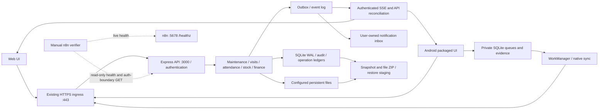

# MADAR system connections and actual n8n verification

Audited application source: `e2aa41b116fcd2ca40138d083247de43e0ca82f6` (`main`). Date: 13 November 2026, Africa/Cairo. This directory adds evidence and n8n workflows; it does not change application code or the deployed APK.

## Open the workflows

- **Main canvas, real HTTP checks and grouped business-connection evidence:** [System Connections + Live Verification](http://carlos-pc.tail852ef0.ts.net:5678/workflow/MadarReadOnlyVerifier20261113).
- **Documentation-only view:** [Actual System Connections — Evidence Map](http://carlos-pc.tail852ef0.ts.net:5678/workflow/MadarConnections20261113).
- On the Ubuntu server desktop, replace the host with `localhost:5678` if necessary. The hostname link uses the existing Tailscale network. Existing n8n login is required; no new public ingress was created.

The main canvas has **18 real HTTP Request nodes** connected to assertions and a final failure gate. Business connections are documented in grouped Sticky Notes below the executable checks, with producer → consumer, API/file interface, source links, test evidence and limits. The n8n wires carry verification results. They do not secretly route MADAR business transactions through n8n.

Both workflows were imported into the existing personal project as **new, inactive workflows**. The existing nine workflows were preserved. Inactive workflows can be run manually with **Execute Workflow**. No schedule or alert destination was configured, and no existing workflow was activated, overwritten or deleted.

[Post-import comparison](n8n-live-import-integrity.json) matched all nine previous workflow definitions against the protected pre-import snapshot: **zero changes**. The n8n SQLite integrity check returned `ok`.

## What ran

| Check | Actual result |
|---|---|
| Installed n8n / node compatibility | n8n **2.46.7**; supported Manual Trigger 1, Code 2, HTTP Request 4.2 and Sticky Note 1 checked against installed node classes |
| JSON / expressions / references / connections / embedded credentials | Parsed and statically validated; no embedded credential values; no noOp or Execute Command nodes |
| Isolated import | Both final files imported into temporary n8n SQLite |
| Successful fixture | 18 probes passed; fixture-only output explicitly marked synthetic |
| Deliberately failed fixture | The local API fixture returned **503**; exactly that probe failed, the other 17 passed, and the final gate produced an error execution / nonzero CLI exit |
| Actual live targets from isolated runtime | All 18 read-only GET checks passed |
| Actual execution stored in live n8n | Execution **27**, `success`, 13 November 2026 **17:35:54–17:35:56 Cairo**; 18/18 live checks passed |
| Final summary | `liveOperationalStatus=PASS`, `overall=VERIFIED_WITH_GAPS`, `releaseAcceptance=NOT_ESTABLISHED`, `allConnectionsProven=false` |
| Physical device | No device listed by ADB; acceptance blocked |
| Authenticated production business checks | Blocked: no n8n credentials configured. Anonymous 401 checks prove denial, not successful business functionality |
| Alerts / schedules | Not configured / not activated |

The original complete V2 suite ran against the audited revision with temporary databases, storage and local HTTP servers: **163 tests, 162 passed, 1 failed, 0 skipped**. The failure is `TEST-001`: `rep-api.test.js:283` still expects a `2.0.6` download filename, while the server now returns `2.0.7`. That large rep test stopped at this assertion; its later scenarios did not run in the original full-suite execution.

A separate disposable copy changed only that expected filename to the actual `2.0.7`, preserving every other assertion and its ordering. That run passed **3/3**, including the full rep integration scenario. Original source/tests were not edited. Do not add these three to the full-suite denominator: they are a separate adapted-contract verification. [Method](rep-current-contract-method.json), [original XML](v2-tests.junit.xml), [adapted XML](rep-current-contract.junit.xml).

Two initial n8n attempts failed before acceptance: the Code sandbox did not expose the global `URL`, and text HTTP responses defaulted to the `data` property. The delivered configuration uses an explicit origin allowlist and `outputPropertyName=body`. Earlier attempt logs/results are retained and explicitly invalid for acceptance; the final files' SHA-256 values are bound in [runtime results](n8n-runtime-results.json).

## Coverage and meaning of the statuses

[Source inventory](source-inventory.json) uses Babel AST parsing of mounted Express routers, client API/fetch/API-URL-builder call sites, native API path literals, event producers/consumers and test declarations. It found:

- **193** mounted API/download route definitions, including aliases.
- **133** client API or API-URL-builder sites. A nested `fetch(apiUrl(...))` may contribute two syntax sites; these are not 133 unique network operations.
- **8** native API path literals, **89** event producer/consumer entries, and **163** test declarations.

Dynamic paths, native URL construction, externally consumed routes and shared helpers limit static matching. An unmatched call or route is not automatically a defect. This inventory establishes the source surface, not live acceptance for every endpoint.

[Connections inventory](connections.json) groups that surface into **43 curated system boundaries**: 30 `VERIFIED_PASS` within the stated source/test/inspection scope; 4 `IMPLEMENTED_NOT_VERIFIED`; 6 `BLOCKED_PREREQUISITE`; 1 optional `NOT_IMPLEMENTED` (closed-app push); 2 `NOT_APPLICABLE` to the current V2 runtime. A passing server/unit test does not turn a native or phone-dependent journey into a device pass.

Particular limits:

- The work claim is keyed by maintenance **card**. The current tests prove visibility/exclusion for representatives sharing that card; a machine-global lock across separate orders is not established by this evidence.
- Event/outbox publication and cursor tests do not establish that every business commit and event publication are atomic across all routes. Authoritative API refresh remains necessary.
- A client biometric result is an assertion from the client; this evidence does not establish independent hardware attestation.
- Backup/restore tests use isolated copies. The local external disk is not proof of an off-device disaster recovery drill.
- The APK manifest is bound to `e2aa41b`, version `2.0.7 (9)`. No installed-phone or authenticated download acceptance is fabricated.
- `system/` is the legacy package/migration source. `madar-flow/` is a separate workflow product. Neither is n8n or an automatic live synchronization layer for MADAR V2.

This diagram describes inspected source connections. Phone-dependent edges and authenticated production business behavior retain their individual blocked/unverified status in the inventory.

## Files and safe use

| File | Purpose |
|---|---|
| [n8n-live-verifier.json](n8n-live-verifier.json) | Main importable workflow: actual read-only HTTP checks, explicit assertions, structured summary/failure gate and grouped source-connection notes |
| [n8n-system-connections.json](n8n-system-connections.json) | Documentary evidence map, Sticky Notes only; not an executable business integration |
| [connections.json](connections.json) | Machine-readable connection IDs, source revision, paths/line numbers, verification methods, statuses, tests and limits |
| [source-inventory.json](source-inventory.json) | Route, client/native contract, event and test declaration inventory |
| [test-results.json](test-results.json) | Original and adapted-contract test counts and failure |
| [n8n-static-validation.json](n8n-static-validation.json) | Installed node/version and structure checks |
| [n8n-runtime-results.json](n8n-runtime-results.json) | Final isolated import/success/failure/live-target execution evidence and workflow hashes |
| [n8n-live-results.json](n8n-live-results.json) | New live workflow identities, inactive state, execution 27 and sanitized final summary |
| [TEST_PLAN.md](TEST_PLAN.md) | Reviewed target separation, risks, failure injection and limits |
| [inventory-source.cjs](inventory-source.cjs) | Read-only source parser; never imports the application or reads secrets |
| [generate-deliverables.py](generate-deliverables.py) | Rebuilds inventories/workflows from evidence files; anchors must exist in source |
| [validate-n8n.cjs](validate-n8n.cjs) | Parses JSON, instantiates installed node classes, validates syntax/references, GET safety and credential scan |
| [verify-runtime.py](verify-runtime.py) | Disposable n8n acceptance harness; synthetic fixture and actual read-only GET targets; independent temporary SQLite / runner ports |

Import via n8n **Import from File**, choosing the two JSON workflow files, keeping them inactive. Importing into another n8n instance requires the same supported node versions and reachable configured service origins. The saved live workflow IDs are already imported here; importing copies again is unnecessary.

The main configuration declares all probe URLs, expected HTTP status/body rules, source revision, dated evidence snapshot and its 24-hour maximum age. All requests are GET, have 5-second timeouts and at most two attempts. They have no write endpoints, shell execution or production credentials. Never interpret a successful 401 probe as authenticated acceptance.

The workflow does not read current Git HEAD, rebuild an APK or independently refresh the embedded test evidence. A snapshot younger than 24 hours can still be outdated after a new deployment. Regenerate and revalidate after source or artifact changes; the live HTTP results prove only their explicitly named checks.

Click **Execute Workflow**, then inspect **Structured results - never universal success** and the final gate. Required live-check failure produces a red/error execution. Missing devices/credentials and the stale original test are visible even when live operational checks pass. Evidence older than 24 hours fails the prerequisite instead of silently asserting current source behavior.

To refresh, independently establish the intended source revision; review test setup; rerun the unmodified V2 suite in its temporary targets; recreate the separately labelled adapted contract only if still necessary; rerun `inventory-source.cjs`, `generate-deliverables.py`, `validate-n8n.cjs`, and `verify-runtime.py`. Review the regenerated files before importing an update. Do not run the generated audit scripts against a production database or create a scheduled production mutation path.

No schedule is included, so only the workflow timezone `Africa/Cairo` applies to display and future explicit scheduling. Alert delivery remains unconfigured and unverified; no authorized destination was supplied.

Earlier valid work was reused: installed node compatibility checking, explicit timeout/response handling, isolated n8n import/execution and source-evidence grouping from `audit/final-integration-20261111/`. Old live diagrams and the pre-existing scheduled check were inspected and preserved. Their noOp/static labels are not reused as proof of functioning business integrations.
